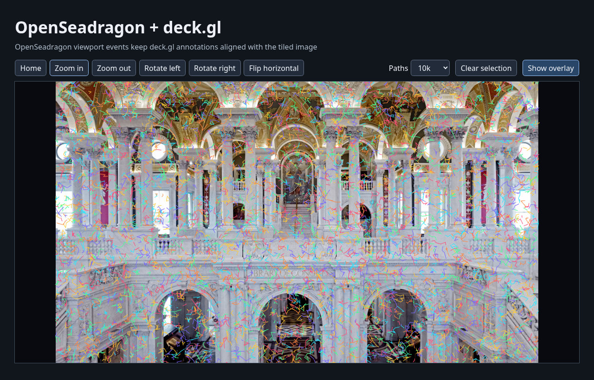

# OpenSeadragon + deck.gl

A deep-zoom image viewer with an interactive vector overlay. OpenSeadragon loads and navigates a tiled photograph. deck.gl draws seeded confetti paths that stay aligned with the image as you pan, zoom, rotate, or flip it.

**[Live demo](https://nlevick.github.io/osd-deckgl-prototype/)**

## Motivation

I built a D3 and SVG annotation overlay for a production deep-zoom viewer that handled up to 10,000 annotations. When new requirements called for hundreds of thousands of complex annotations, I explored GPU-accelerated rendering with deck.gl.

Moving both tiles and annotations to deck.gl would have required rewriting the viewer. This prototype tests a smaller migration. OpenSeadragon still handles tiles and navigation, so the existing viewer can keep its custom features. deck.gl draws and picks synthetic annotation paths while following OpenSeadragon’s camera.

In an earlier polygon benchmark, rendering and picking performed similarly with OpenSeadragon driving the camera and with deck.gl on its own (camera sync took about 2 ms at the 95th percentile).



## Run locally

Use Node.js 22.12 or later in the 22.x series, Node.js 24, or Node.js 26, with npm.

```sh
npm ci
npm run dev
```

Open the local URL Vite prints. The viewer needs network access to the demo image's Deep Zoom Image (DZI) descriptor and tiles.

Image request failures show a **Retry image** button. [OpenSeadragon DZI example](https://openseadragon.github.io/examples/tilesource-dzi/)

The overlay requires WebGL2. If the overlay fails, the image viewer and its navigation controls remain available.

## Viewer

- Drag to pan. Use the wheel, double-click, pinch, or the toolbar to zoom. Use **Home** to restore the initial framing and orientation.

- Hover over a path to preview it, then click or tap to select it. The selection follows the image as you pan, zoom, rotate, or flip it. Click empty space, press **Escape**, or use **Clear selection** to clear it.

- Use **Paths** to switch between 10k, 50k, and 200k paths. **Show overlay** toggles the confetti. Changing either setting clears the selection.

## Checks and production build

```sh
npm run typecheck
npm test
npm run build
npm run preview
```

- [Architecture](docs/architecture.md)
- [Image credit and third-party notices](THIRD_PARTY_NOTICES.md)
